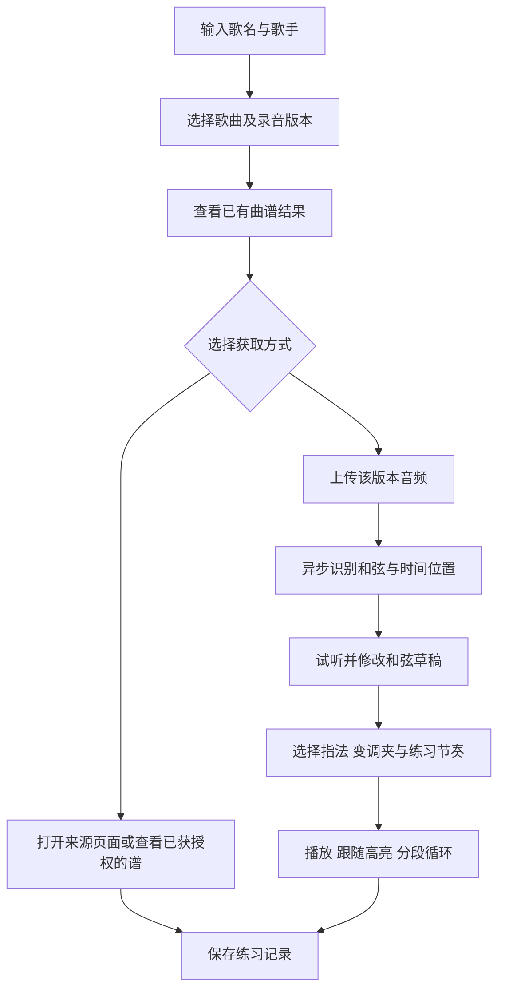

# 吉他弹唱助手：项目计划 v0.2

日期：2026-10-21  
状态：第一版已实现并发布到 GitHub Pages；真实流行歌识别质量评估、更多曲谱来源与后续功能继续按验证结果推进。  
暂定名称：吉他弹唱助手（品牌名称后定）。

实际产品名：弦记 Stringnote。网站：[在线使用](https://aeb73d53.github.io/stringnote/)。仓库：[AEB73D53/stringnote](https://github.com/AEB73D53/stringnote)。本文件保留原始规划，当前实现选择与边界以 [实现说明](docs/IMPLEMENTATION.md) 和 [验证记录](docs/VALIDATION.md) 为准。

## 1. 产品目标与默认假设

让用户输入一首想弹的歌，获得来源明确、能看懂、弹得出的吉他练习版本。围绕“找歌 → 获取谱 → 调整难度 → 跟着练”完成一次使用。

本计划的默认假设，均可调整：

- 用户：吉他初学者到初中级弹唱用户，优先服务中文流行歌曲。
- 设备：响应式网站，电脑适合编辑、手机和平板适合看谱练习。
- 乐器：六弦吉他、标准调弦；第一版以弹唱和弦谱为主要输出。
- 首发：先自用或邀请制小范围试用，再决定公开运营与商业化。
- 部署偏好：代码托管于 GitHub，网站前端优先部署到 GitHub Pages，通过 GitHub Actions 构建发布；分析服务是否需要外部托管由验证决定。
- 获取方式：输入歌名和歌手找谱；提供音频上传入口生成和弦草稿。
- “生成谱”首先指从音频识别和弦、形成练习编配。按文字要求从零创作新曲是后续独立能力。

首发价值在于帮助用户开始练习，而不是承诺任何歌曲都能被完整还原。自动生成结果允许人工校正，页面清楚标注来源和版本类型。

## 2. 用户流程

补充入口：可以直接上传音频，不强制先完成歌名搜索。未找到现成谱时，展示真实的无结果状态，同时提供上传音频和手动录入和弦的入口。分析失败时保留可重试的任务，不用通用和弦进行冒充识别结果。

同一首歌的原唱、现场、翻唱可能有不同调性与节奏。搜索结果展示歌手、版本及可获得的来源信息；版本未确认时保留“版本未知”，不把不同录音混为同一分析结果。

## 3. 第一版范围

首发 V1 由“找谱与练习”和“音频识别测试版”共同组成；音频识别是否达到首发标准，由前置验证决定。视觉原型仅用于确认体验，不能视为功能交付。

| 模块 | 第一版包含 | 验收关注点 |
| --- | --- | --- |
| 歌曲搜索 | 歌名、歌手、同名歌曲区分；先接入一个稳定且可使用的数据源 | 验证浏览器跨域访问是否可行；静态谱库、来源外链与实时检索分别标明，不能互相冒充 |
| 曲谱结果 | 标注来源、格式、录音/编配版本、原调与指法调（已知时）、版本类型 | 外链结果与站内可练习谱有明确区别 |
| 看谱 | 结构化和弦谱与指法图；用户自有图片谱的查看、缩放和手动滚动 | 手机可读，指法与和弦名称对应 |
| 音频识别 | 暂定支持 MP3/WAV，单文件最长 10 分钟、最大 50 MB；输出和弦时间轴和可编辑草稿 | 优先验证浏览器推理，保留独立后端候选；文件限制按设备表现校准，任务状态反映真实处理 |
| 编辑纠错 | 修改和弦、拆分/合并片段、调整换和弦位置、试听与撤销 | 修改后谱面、指法和播放高亮保持一致 |
| 降低难度 | 推荐开放和弦指法与变调夹位置；少量可解释的和弦简化规则 | 保留原始分析结果，简化版另存；不能保证所有歌都适合免横按 |
| 练习播放 | 原音频播放、当前和弦高亮、A–B 循环、变速练习、节拍器 | 暂停/跳转/循环后同步可靠；参考节奏与识别节奏有区分 |
| 保存导出 | 本机练习列表；结构化和弦数据/ChordPro 导出；浏览器打印可用内容 | 音频清理后仍可保存和弦成果；外部曲谱不默认复制导出 |

第一版生成的基础成果是“带时间位置的和弦谱”。有用户提供或可使用的歌词时，可以附加歌词和弦排版；自动识别整首歌词并逐字对齐作为后续增强。

第一版以几种预设扫弦/分解节奏供用户选择，并清楚标为练习建议。这些节奏不表示已还原原曲的右手演奏。

图片谱与结构化谱分别处理：图片可以直接查看；移调、和弦编辑与精确时间同步需要结构化数据。第一版不假设图片导入后自动具备这些能力。

## 4. 页面与体验

采用安静、清楚、适合长时间看谱的音乐工具风格。第一版提供五个主要界面：

1. **首页**：歌名/歌手搜索框、上传音频入口、最近练习。
2. **搜索结果页**：歌曲与版本、曲谱来源、格式和可执行操作。
3. **处理状态页**：本地读取或上传、解码、分析、生成结果；后端模式增加排队状态；提供失败原因、重试和取消。浏览器模式明确提示文件留在本机。
4. **练习工作台**：桌面中间显示谱面，侧边显示当前指法，底部固定播放工具；手机显示当前与下一个和弦，编辑控件按需展开。
5. **我的练习页**：本机收藏、最近练习、导入和导出；后续再增加跨设备同步。

谱面区优先保持清晰。来源谱、AI 识别草稿、人工修改版、简化编配版分别标明；低确定性片段提示用户试听核对，未经校准的模型分数不显示为“准确率百分比”。

## 5. 技术方案（候选，验证后确定）

网站前端以可静态导出的 Web 应用为基础，优先部署 GitHub Pages。GitHub 仓库保存代码，GitHub Actions 负责构建、检查和发布；Pages 本身不运行 Python/FastAPI、Node 动态接口或服务端数据库。

音频执行方式保留两条候选路线，阶段 A 比较后确定：

- **浏览器模式（优先验证）**：在用户设备解码并推理，模型作为静态资源加载。参考 Basic Pitch TypeScript 与 EarChords 的实现；验证真实歌曲效果、桌面/手机耗时和内存后，才决定是否作为主要方案。
- **服务端模式（质量或设备性能需要时）**：Pages 前端调用独立部署的 Python 分析服务，沿用后台任务方案。代码仍可统一在 GitHub 管理，但计算服务需要额外的运行平台。

当前只确认 GitHub 部署偏好，没有将用户要求解释为“仅允许 GitHub 一个平台”，也没有因此取消自动生成或真实找谱的目标。如果用户要求完全不使用外部服务，需要根据验证结果重新确定实时搜索和识别范围。

| 层 | 候选方案 | 职责 |
| --- | --- | --- |
| 静态前端 | Next.js 静态导出 + TypeScript | 搜索界面、谱面、工作台和任务交互；不用运行时 Server Actions 或动态 API 路由 |
| 构建发布 | GitHub Actions + GitHub Pages | 检查、构建并发布静态产物；Actions 不用作网站访客的实时音频处理服务 |
| 浏览器分析候选 | Web Audio + Web Worker + 可浏览器运行的识别模型 | 本机解码、和弦分析和结果生成，尽量保持界面响应；模型接入方式需实测 |
| 服务端分析候选 | Python + FastAPI，独立分析进程 | 质量或设备性能需要时使用；独立托管，不放进 Pages |
| 音频预处理 | 浏览器解码与重采样；后端模式使用 FFmpeg | 统一格式、采样率与声道 |
| 弹唱谱展示 | ChordSheetJS 与独立指法组件 | 歌词/和弦排版、谱面输出与移调表现 |
| 播放 | 浏览器音频能力 | 原音频、时间轴高亮、循环和变速；具体兼容性实测 |
| 数据保存 | 浏览器模式用 IndexedDB；后端模式小规模用 SQLite | 本机练习与谱面版本；服务端任务状态另存，多实例需要时再评估 PostgreSQL |
| 文件 | 浏览器模式读取本机文件；后端模式使用临时文件/对象存储 | 浏览器不把用户音频写入 GitHub 仓库；长期本机保存提供导出备份 |
| 后续完整谱面 | alphaTab | Guitar Pro/MusicXML 等完整谱面展示与播放 |

分析能力封装为可替换的适配器，前端使用统一的任务与结果结构，避免把界面绑定到某个模型。服务端路线参考 ChordMini 的和弦识别实现，浏览器路线参考 EarChords；不把通用聊天模型当作音频识别引擎。聊天模型可在后期辅助解释与编配建议，输出必须通过和弦与节奏规则检查。

服务端模式由独立进程领取数据库中的任务，处理超时、重试上限、取消和重复提交；按内容标识缓存音频分析结果，保存模型与参数版本。缓存复用必须保留会话/用户权限隔离，不能因此暴露他人文件。分析规模上升后再引入专门队列和多个计算节点。浏览器模式则在本机管理任务生命周期，并处理页面刷新、关闭和设备内存不足。

服务端模式初期以受控的小范围试用运行，任务结果通过会话与不可猜测的访问令牌保护；公开服务前落实用户身份、访问隔离、上传限制和分析并发限制。Pages 前端不承担访问保护：普通 Pages 页面即使来源仓库私有，也不应被假定为邀请制访问；浏览器本机文件与练习数据不随页面发布。

### 5.1 GitHub Pages 部署验收

- 用 Actions 构建静态产物并部署；处理项目站点的仓库子路径、字体、指法图片、模型与 Worker 资源路径。
- 练习工作台采用固定导出路由加查询参数/本机状态，或采用可静态生成的路径；直接访问和刷新不能依赖服务器重写。
- 未知歌曲与本机导入结果不要求构建时预知，不使用无法静态导出的动态路由能力。
- 搜索区分静态谱库、跳转原站搜索和 API 实时聚合。浏览器只能直接读取允许跨域访问的公开来源；需要服务端抓取、代理或私密凭据的来源，由可选后端处理。
- 需要保密的 API 密钥只放在实际执行服务端逻辑的环境中。Actions Secrets 若被构建写入浏览器 JS，仍会暴露；不能用它解决前端密钥保护。
- 不将用户音频、私人谱库或数据库打包发布。构建阶段只预处理明确可使用的公共数据，并标注更新时点。
- 在实际 Pages 地址验证首屏、路由刷新、模型加载、音频分析、播放与文件导出；本地开发成功不能代替线上验收。

## 6. 数据与音乐语义

内部保留统一结构，展示库不承担数据存储的全部职责：

- **歌曲**：标题、歌手、别名；代表作品。
- **录音版本**：原唱/现场/翻唱、时长、来源标识或音频标识。
- **谱面版本**：指向作品及适用录音（未知时允许为空），记录图片/结构化格式、来源、可使用范围、原始/识别/简化/人工修改类型，以及父版本。
- **和弦片段**：起止时间、和弦根音、性质、低音、原始标签及模型分数；可附加节拍位置。
- **谱面结构**：拍号、调性、段落和节拍均允许未知；模型未可靠识别时不制造确定值。
- **练习设置**：变速、显示移调、变调夹、循环范围、偏好指法。
- **分析任务**：文件引用、状态、模型及参数版本、耗时、错误类型、过期时间。

特别区分三个概念：

1. **实际发声和弦**：录音中听到的和弦。
2. **手上使用的指法**：例如用 G 指法加变调夹 2 品，实际发声为 A。
3. **音频是否移调**：单独升降谱面不会改变原录音音高。第一版如果只改了显示或指法，必须明确当前跟原音频是否匹配。

变调夹推荐以保留实际发声和弦为目标，单纯移调则会改变预期发声调性。更换练习速度时使用真实音频播放时间驱动高亮，不另起计时器假定同步。现场自由速度、三拍子或节拍不可靠时，优先展示时间轴，不强制塞入错误的小节网格。

## 7. 前置验证与验收

以下数值是建议的验收目标，尚无实测结果；验证结束后调整范围与估期，不对外承诺任意歌曲的准确率。

### 7.1 数据源验证

- 先确认一个可接入的真实来源，记录能获取的是搜索信息、外链、图片还是结构化谱。
- 从 Pages 同类来源环境验证跨域访问与凭据要求；确定是否可完全在浏览器完成，还是需要独立搜索接口。
- 准备 30 个查询，覆盖常见歌名、歌手组合、同名歌、现场版和无结果情况。
- 统计正确歌曲/版本在前三条结果的比例、可实际打开的来源比例和响应时间，不把“有搜索结果”等同于“有可编辑谱”。
- 可用来源不足时，明确采用自建可使用谱库加外链搜索的首发范围，并重新确认覆盖目标。

### 7.2 音频识别验证

- 使用有使用权限的真实录音，准备 20 段 30–60 秒测试片段；15 段常规流行编曲，5 段包含复杂编曲、现场或转调。
- 在同一批样本上比较浏览器与服务端候选；浏览器测试至少覆盖桌面和一台真实手机，包含模型首载与分析期间页面响应。
- 由懂吉他的人标注参考和弦与换和弦时间；同一批片段比较候选模型，另留片段做最终核验，避免只挑表现好的歌。
- 建议初始目标：常规组的时长加权基础和弦匹配率达到 80%，有效覆盖至少 90% 的有和声时段。基础标签先统一根音与大/小性质；七和弦、转位等另报，不把基础标签分数宣传成完整和弦准确率。
- 分别报告有和声时段、无和弦/静音时段和无法判断时段；复杂组单独报告，保留所有失败样本。
- 记录换和弦边界误差、节拍可靠程度、完整歌曲的处理时间、内存峰值和实际运行成本。
- 增加 3–5 首完整歌曲检查累计漂移、长任务稳定性与结果编辑体验。片段测试不能代替整曲测试。
- 识别验证未达标时，先尝试更换模型或限制适用录音，再与用户调整首发范围；不得以模拟结果替代。

### 7.3 产品验收

- 用至少 3 首可使用的示例完成“检索/上传 → 识别 → 修改 → 练习 → 导出”全流程。
- 结构化和弦的名称、指法与变调夹关系通过确定性用例验证；移调往返后恢复原值。
- 编辑后撤销、保存与重新打开保持谱面一致；原始分析结果可以恢复。
- 桌面和手机完成播放、暂停、跳转、循环；高亮与已存时间轴之间的偏移目标在测试设备上不超过 200ms。这只验证播放器同步，不代表模型边界识别达到同样精度。
- 搜索来源超时、错误格式、分析失败、任务取消和文件过期都有可理解的状态和恢复入口。
- 在真实 GitHub Pages 项目子路径下完成直接访问、刷新与静态资源加载验证；联网找谱测试区分站内结果和原站外链。
- 邀请 5–10 位目标用户试用，记录能否找到并开始练习、实际需要修正多少和弦、哪些指法仍然困难。通过实测确定是否值得增加自动编配功能。

## 8. 开发阶段与估期

按一名熟悉 Web/Python 的开发者，复用现有模型、有可使用的数据来源、先做小范围试用估计。以下为工作量范围，不是已确认交付日期。

| 阶段 | 预计工作量 | 可查看的交付物 | 进入下一阶段的条件 |
| --- | --- | --- | --- |
| A：核心验证 | 2–4 个工作日 | 来源能力清单、浏览器/后端识别样例、质量/耗时/资源报告、Pages 静态发布最小验证 | 至少一个来源路径成立；确定识别执行位置及是否需要外部服务 |
| B：交互原型 | 3–5 个工作日 | 首页、搜索、练习工作台的可点击原型，含手机布局 | 核心流程与首发范围确认 |
| C：首个可用版本 | 5–8 个工作日 | 真实检索、可使用示例谱、指法、编辑、播放、本机保存 | 找谱和练习基础流程可实际完成 |
| D：接入音频分析 | 7–12 个工作日 | 本机读取或真实上传、分析任务、和弦时间轴、纠错、简单编配建议 | 通过模型核验、目标设备和整曲联调 |
| E：小范围试用 | 3–5 个工作日 | Pages 自动发布配置、真实线上端到端验证、部署说明、问题清单和试用反馈 | 主要失败状态可恢复，线上路径与资源加载正常 |

合计约 5–8 周，包含约 20% 联调缓冲。只有视觉原型通常可以先在 3–5 个工作日形成，但不包括真实识别能力。核心验证若发现模型、来源或部署环境不满足要求，需要重新估期。

浏览器模式的主要开销是静态资源分发，计算由用户设备承担；GitHub Pages 的使用条件与额度按账号及届时政策核实，不笼统承诺所有部署均免费。若需要独立后端，再增加分析算力与临时存储成本。阶段 A 测出单首耗时、设备表现后确定方案；此时不提供未经验证的月费用或单首价格。前述 5–8 周估期在验证执行路线后重新核对。

## 9. 后续路线

| 版本 | 重点 | 前提 |
| --- | --- | --- |
| V1.1 | 歌词导入与对齐、更多可靠数据源、谱面分享、跨设备收藏 | 核心找谱与练习体验成立，使用权限与账户方案明确 |
| V2 | 更好的段落检测、保留声部的简化编配、可试听的伴奏生成、可选音频移调 | 有足够质量样例与真实用户反馈 |
| V3 | 完整六线谱、旋律/指弹转写、弦品分配优化 | 对分轨、音符识别、时值量化和可弹奏性分别验证 |
| 独立创作模式 | 输入风格/难度/旋律，创作新的和弦进行与吉他练习曲 | 用户确认这是重要目标，再单独设计与估期 |

原曲识别、简化编配和原创作品各自保存，避免让用户误以为自动生成的编配等同于原曲谱。

## 10. 主要依赖与处理方式

| 不确定性 | 实际影响 | 计划中的处理 |
| --- | --- | --- |
| 曲谱来源与可使用范围 | 影响搜索覆盖与站内展示、保存和导出 | 优先元信息与来源链接；站内谱使用自有、明确可用或用户提供的内容；逐项记录可用能力 |
| 识别质量 | 决定音频生成是否可用于首发 | 前置验证、保留人工纠错与原结果、复杂情况明确限制 |
| 模型及依赖许可证 | 影响能否按目标方式部署与运营 | 按代码、权重和依赖分别核实，保留归属说明；仓库开源不自动覆盖所有资源 |
| 外部来源不稳定 | 搜索或导入可能失效 | 来源适配器隔离、超时与降级；仍能上传音频或使用自有谱 |
| 处理时间和资源 | 影响等待体验与成本 | 异步任务、并发上限、缓存与文件时长限制；实测后决定计算方式 |
| 音频与用户数据保存 | 影响隐私和长期费用 | 浏览器模式文件留在本机，说明刷新/浏览器清理影响；后端模式建议临时音频 24 小时清理，支持主动删除；和弦成果另存，期限待确认 |
| GitHub Pages 静态托管边界 | 影响动态搜索、私密 API 和服务端推理 | 浏览器能力优先验证；必要时前端保持 Pages，动态服务独立部署；不以 Actions 代替实时后端 |
| 从参考仓库复用 | 依赖多、部署耦合可能增大首版工作量 | 先验证可复用模块，默认独立应用接适配器；整体 fork 是否更快由阶段 A 决定 |

## 11. 开源参考与使用边界

以下依据仓库公开说明核实功能，尚未完成本地部署或识别质量测试。

- [ChordMiniApp](https://github.com/ptnghia-j/ChordMiniApp)：参考和弦、节拍、指法与音频交互；其旋律转写明确为实验能力。
- [tabstand](https://github.com/TeigenZhang/tabstand)：参考中文谱源检索与图片谱管理，不能据此假定所有来源允许站内转载。
- [ChordSheetJS](https://github.com/martijnversluis/ChordSheetJS)：候选弹唱谱解析、排版与移调库。
- [alphaTab](https://github.com/CoderLine/alphaTab)：候选后续完整谱面渲染与播放库，不负责从音频识别音符。
- [Basic Pitch](https://github.com/spotify/basic-pitch)：后续音频转 MIDI 的候选组件；官方说明单次处理一种乐器效果最好，不等同于整曲自动生成六线谱。
- [Basic Pitch TypeScript](https://github.com/spotify/basic-pitch-ts) 与 [EarChords](https://github.com/Hicruben/earchords)：参考浏览器推理与和弦后处理；后者说明复杂完整混音更难，不能把演示能力视为真实流行歌识别质量保证。
- [GitHub Pages 官方说明](https://docs.github.com/en/pages/getting-started-with-github-pages/what-is-github-pages)、[Actions 发布工作流](https://docs.github.com/en/pages/getting-started-with-github-pages/using-custom-workflows-with-github-pages) 与 [Next.js 静态导出](https://nextjs.org/docs/app/guides/static-exports)：部署能力及限制依据。

## 12. 已确认偏好与待调整选择

已确认：用户选择 GitHub 仓库、Actions 和 Pages 为前端发布路径，实际仓库为 `AEB73D53/stringnote`，已完成首次发布。第一版音频分析在浏览器本机执行，尚未部署外部分析后端。

1. **主要用途**：推荐先服务自己与小范围试用；如果目标是公开商业网站，需要提前纳入账号、来源授权与运行预算。
2. **核心卖点**：推荐找谱和练习为主，音频识别作为首发测试能力；如果更看重“找不到也能自动生成”，应增加模型验证投入，并接受更长周期。
3. **首发谱面**：推荐弹唱和弦谱与指法图；如果必须包含完整六线谱，需要改变技术目标和估期。
4. **“创作”的含义**：推荐先做已有歌曲的识别与简化编配；如果要从零创作新曲，应增加独立创作模式。

后续优先使用真实、有使用权限的歌曲录音核验自动草稿质量，并验证更多曲谱来源；已交付功能与已知限制见当前实现说明。
