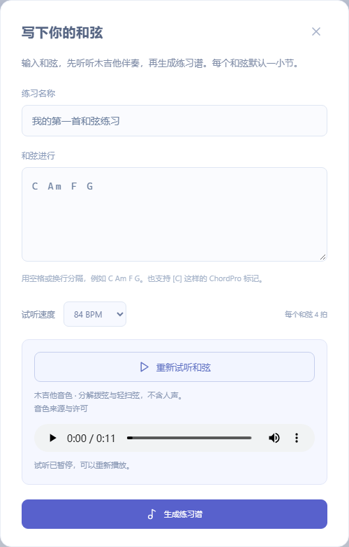
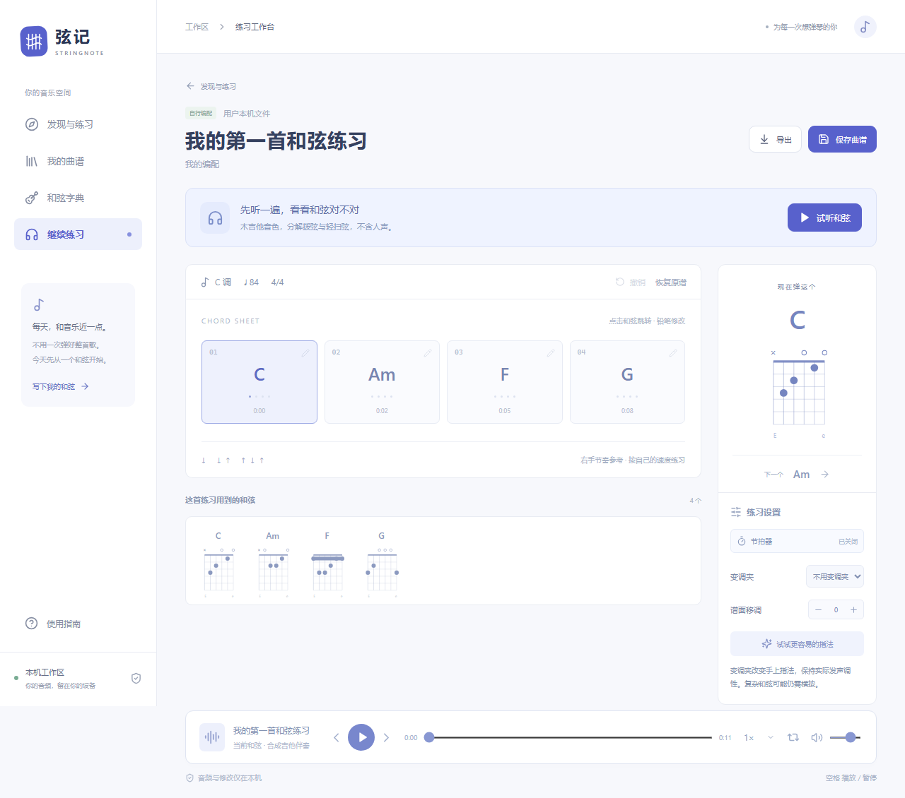
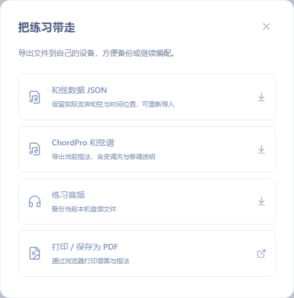

# 弦记完整使用指南：第一次用，从这里开始

适用版本：2026 年 10 月 22 日。下文按钮名称以这个版本为准。

[打开网站](https://aeb73d53.github.io/stringnote/) · [回到项目首页](README.md)

弦记可以帮你找曲谱来源、把和弦变成吉他伴奏、分析自己的录音，以及保存练习谱。打开网站就能用，不需要注册，也不需要安装软件。

**如果你只想先听到声音，先完成下面的“一分钟上手”。其他功能可以用到时再查。**

## 目录

- [1. 一分钟上手：写四个和弦，听吉他伴奏](#quick-start)
- [2. 我想做什么，应该点哪里？](#where-to-start)
- [3. 不写和弦，直接试内置练习曲](#practice-tracks)
- [4. 输入歌名，寻找已有曲谱](#search)
- [5. 自己写和弦：输入规则、速度、试听](#compose)
- [6. 导入录音，生成和弦草稿](#audio)
- [7. 看懂练习工作台与播放器](#workbench)
- [8. 修改和弦、调整时间、拆分、合并、撤销](#edit)
- [9. 移调、变调夹与重新生成音频](#transpose)
- [10. 慢速播放、节拍器与反复练一小段](#practice-tools)
- [11. 收藏、保存、重新打开与移除](#save)
- [12. 导出：音频、和弦文件、PDF](#export)
- [13. 导入和弦文件与图片谱](#import)
- [14. 和弦字典怎么看？](#dictionary)
- [15. 手机、键盘与关闭弹窗](#mobile)
- [16. 常见问题与排查办法](#faq)
- [17. 常用按钮速查](#buttons)

<a id="quick-start"></a>
## 1. 一分钟上手：写四个和弦，听吉他伴奏

1. 打开[弦记网站](https://aeb73d53.github.io/stringnote/)，进入“发现与练习”。
2. 在搜索框上方，点击 **“自己写和弦”**。
3. “练习名称”填 `我的第一首练习`。
4. 把“和弦进行”里的原有文字删掉，输入下面这一行：

   ```text
   C Am F G
   ```

5. “试听速度”先保持 **84 BPM**。这表示每分钟 84 拍，数值越大越快。
6. 点击 **“试听和弦”**。等待伴奏生成，就能听到木吉他音色的伴奏。如果浏览器没有自动播放，再点下方小播放器的三角播放按钮。
7. 想边听边看谱，点击 **“生成练习谱”**。进入工作台后，再点页面上方的 **“试听和弦”**。
8. 想下次接着用，点击右上角 **“保存曲谱”**。以后从左侧 **“我的曲谱”** 打开。

保存只留在这台设备的这个浏览器。重要练习还要导出备份，换手机不会自动同步。

这里的 `C Am F G` 是四个和弦，每个默认持续一小节、4 拍。网站为它们生成吉他伴奏，不会自动生成演唱、人声或一整首流行歌。



<a id="where-to-start"></a>
## 2. 我想做什么，应该点哪里？

| 你想做的事 | 从哪里开始 | 会得到什么 |
| --- | --- | --- |
| 先试试网站，不知道写什么 | 首页的《晚风练习曲》等卡片 | 可播放、修改的练习编配 |
| 已经有一串和弦，想听效果 | 首页 → 自己写和弦 | 吉他伴奏与练习谱 |
| 想找某首流行歌的谱 | 首页输入歌名、歌手 → 找曲谱 | 歌曲版本信息、站外曲谱搜索入口 |
| 手里有 MP3/WAV，想试着识别和弦 | 从音频开始 → 选择音频 | 实验性的和弦草稿，需要自己核对 |
| 有网站导出的文件或 ChordPro 文件 | 我的曲谱 → 导入和弦谱 | 可编辑、试听的和弦时间谱 |
| 有一张曲谱图片 | 我的曲谱 → 导入图片谱 | 可以放大、缩小查看的图片 |
| 某个和弦不知道怎么按 | 左侧 → 和弦字典 | 常用和弦指法图 |
| 想继续当前尚未关闭的练习 | 左侧 → 继续练习 | 回到当前工作台；它不等于保存 |

左上角“弦记”标志也能回首页。“使用指南”在左侧菜单底部；手机上先点左上角菜单按钮展开导航。


几个会反复出现的词：

| 名称 | 用普通话怎么理解 |
| --- | --- |
| 和弦 | 同时配合的一组音，用 C、Am、F、G 这样的字母表示 |
| 和弦进行 | 按顺序弹哪些和弦，例如 C → Am → F → G |
| 片段 | 一段时间里使用同一个和弦；识别录音得到的片段不一定刚好一小节 |
| BPM | 每分钟多少拍；84 比 120 慢 |
| 指法 | 手指在吉他上怎么按；使用变调夹时，指法名称和实际听到的和弦可能不同 |
| 原音频／原录音 | 你选进来的录音文件，可能含人声和其他乐器 |
| 合成伴奏／试听和弦 | 网站按当前和弦生成的吉他伴奏，不含人声 |

<a id="practice-tracks"></a>
## 3. 不写和弦，直接试内置练习曲

1. 回到“发现与练习”。如果刚搜过别的歌，可以用搜索框右侧的叉号清除搜索。
2. 点击练习曲封面上的三角按钮，或点击曲名。
3. 等待伴奏准备好，点击上方“试听和弦”或底部播放按钮。
4. 按照后面的章节，试试改和弦、慢速播放、移调与循环。

“全部”“入门友好”“原创练习”只是筛选内置练习曲。卡片上的书签按钮用于收藏，再点一次会取消收藏。

当前内置《晚风练习曲》《小星星》《欢乐颂》是原创练习或经典旋律的自行编配，使用网站生成的音频。它们不是任意流行歌的原版录音或官方曲谱。

<a id="search"></a>
## 4. 输入歌名，寻找已有曲谱

例如，你想找《晴天》：

1. 在首页搜索框输入 `晴天 周杰伦`，点击 **“找曲谱”**；也可以点搜索框下方的推荐词。
2. 如果出现“先确认，你想弹哪个版本？”，查看歌手、专辑、原版或现场版，点击相应的 **“找这个版本的谱”**。
3. 在“去找……的谱”区域，点击 **“吉他社”“吉他帮”或“全网找谱”**。
4. 浏览器会打开新的搜索页面。在外部网站确认歌曲、版本与编配是否合适。
5. 找到有权使用的图片谱，可以保存图片后，回到弦记导入图片查看；有和弦文字，也可以自行填进“自己写和弦”。

**搜索结果里的歌曲信息不等于已经找到了曲谱。** 歌曲版本信息来自 Apple 曲库；三个谱源按钮打开的是搜索入口。当前不会把外部网站的整份曲谱自动搬进弦记，也不能只凭歌名就保证生成原曲的正确和弦。

搜不到版本时，仍可使用下方站外搜索。出现“内置练习曲中暂时没有这首歌”，只表示小型内置练习库没有匹配，不代表互联网上没有这首歌的谱。

<a id="compose"></a>
## 5. 自己写和弦：输入规则、速度、试听

### 5.1 正确输入一串和弦

点击首页“自己写和弦”，或左侧“写下我的和弦”。给练习起名，把和弦按演奏顺序输入。

用空格或换行分开即可：

```text
C Am F G
C Am Dm G
```

每个和弦默认持续一小节、4 拍。换行只是方便阅读，不会额外增加停顿。同一个和弦想持续两小节，可以连续写两次，例如 `C C Am G`。

常见输入例子：

| 写法 | 含义或用途 |
| --- | --- |
| `C`、`F`、`G` | 大三和弦；根音字母使用大写 |
| `Am`、`Dm`、`Em` | 小三和弦，m 使用小写 |
| `G7`、`Am7`、`Cmaj7` | 常见七和弦 |
| `Dsus4`、`Asus2`、`Cadd9` | 挂留或加音和弦 |
| `F#`、`Bb` | 升号 #、降号 b |
| `D/F#`、`C/G` | 斜杠后是低音，例如 D 和弦使用 F# 作为低音 |
| `N.C.` | 这一段没有和弦；自行写的练习里用它表示伴奏休止 |
| `[C] [Am] [F] [G]` | 带方括号的 ChordPro 和弦标记，也支持 |

当前支持的和弦后缀包括：无后缀、`m`、`7`、`m7`、`maj7`、`9`、`m9`、`maj9`、`11`、`13`、`6`、`m6`、`sus2`、`sus4`、`add9`、`dim`、`dim7`、`aug`、`5`；`min` 和 `min7` 也可以使用。不在支持范围的写法会提示错误。

先用简单和弦即可。不要把歌名、数字简谱或一大段普通歌词当作和弦输入。使用 ChordPro 时，网站提取方括号内的和弦，当前不提供完整的歌词和弦排版。

### 5.2 选择速度，先听后生成

1. “试听速度”可选 60、72、84、96、108、120 BPM。新手先用 60–84。
2. 点“试听和弦”，听当前输入的吉他伴奏。
3. 点“暂停试听”停止；已有伴奏时，“重新试听和弦”会从开头播放。
4. 改过和弦或速度后，再点“试听和弦”，会生成新声音。
5. 满意后点“生成练习谱”，进入工作台。

默认音色是钢弦木吉他，包含分解拨弦与轻扫弦。首次试听需要加载音色，稍等即可；浏览器要求手动播放时，点小播放器的播放按钮。音色文件暂时加载失败时，也会使用本机拨弦模型继续提供试听。

“自己写和弦”是把**你输入的和弦**变成伴奏，不是输入一句要求就自动写出整首歌曲。当前也没有可点击的“扫弦型切换”或“吉他音色选择”菜单。

<a id="audio"></a>
## 6. 导入录音，生成和弦草稿

1. 在首页点击 **“从音频开始”** 或 **“导入我的音频”**。
2. 点击“选择音频”，选择设备上的 MP3/WAV；电脑也可以把一个文件拖到选择区域。
3. 等待本机分析。过程中可以点击“取消分析”，或关闭弹窗取消。
4. 完成后进入工作台，默认关联的是你的原录音。
5. 点击“听原音频”听录音，点击“试听和弦”听网站按草稿生成的吉他伴奏，来回对比。
6. 发现某段不对，点击那一格的小铅笔修改，再试听。核对后点击“保存曲谱”。

可用文件：MP3 或 WAV，最大 **50 MB**，时长 **0.5 秒至 10 分钟**。不支持直接粘贴音乐平台链接、直接导入视频或在网页内录音。过长的歌曲请先在其他工具里裁剪。

这是实验性识别，当前主要给出基础大、小和弦草稿。清晰的单吉他或弹唱录音通常更方便核对；复杂伴奏、鼓声、噪声、七和弦与转位可能识别不准。它不会可靠地自动还原旋律、歌词、右手节奏或完整六线谱。

看到 `N.C.` 或不确定提示时，可能是静音、无和弦，也可能是系统没判断出来，需要听原录音确认。BPM 和调性同样可能需要核对。“待确认”表示暂时没有可靠结果。

录音只在当前设备浏览器中分析，不会上传到 GitHub 或服务器。分析完成不等于已经保存：记得点击“保存曲谱”。

<a id="workbench"></a>
## 7. 看懂练习工作台与播放器



| 区域或按钮 | 怎么使用 |
| --- | --- |
| 上方“试听和弦” | 按当前和弦与移调设置生成吉他伴奏并播放；播放中再点会暂停 |
| “听原音频” | 只有导入过原录音时出现；切回原文件，再点可暂停 |
| 一格一格的和弦 | 每格代表一个时间片段；点击格子跳到该段起点，不一定自动开始播放 |
| 格子里的小铅笔 | 修改这一段的原调和弦及起始时间 |
| 格子下方的时间 | 这一段的开始位置 |
| 右侧“现在弹这个” | 当前格子的指法图；下面显示下一段和弦 |
| “这首练习用到的和弦” | 查看本次需要的指法，最多显示前 16 种 |
| 底部大三角／暂停按钮 | 播放或暂停当前选择的音频；看曲名下的小字确认是原录音还是合成伴奏 |
| 播放按钮左右的箭头 | 跳到上一段、下一段和弦 |
| 播放进度条 | 拖动到想听的位置 |
| 音量滑块 | 调整网页内播放器音量；没有声音时也检查系统音量 |
| 右上“保存曲谱” | 把当前谱面保存到本机谱库 |
| 右上“导出” | 下载谱面数据、当前音频或打印 PDF |

**如果底部标着“本机原音频”，点底部播放仍然是原录音。想听改过和弦后的效果，请点上方“试听和弦”。**

播放时格子高亮会跟随音频时间走。谱面下方的 `↓ ↓ ↑ ↑ ↓ ↑` 是右手节奏参考，不是识别出的原曲扫弦，也不是一个可点击的节奏设置。

工具栏的“C 调”等文字显示谱面的基础调性。移调后的实际试听以“谱面移调”的数值为准，变调夹后的格子文字是手上指法，二者不要混为一谈。

<a id="edit"></a>
## 8. 修改和弦、调整时间、拆分、合并、撤销

### 8.1 改错的和弦

1. 点击目标格子右上角的小铅笔。
2. 在“实际发声和弦”中输入**移调之前的正确和弦**，例如 `Am` 或 `G7`。这个输入框的内容不会跟随移调改名。
3. 点击“保存修改”。
4. 回到工作台，点“试听和弦”生成修改后的声音。
5. 最后点右上角“保存曲谱”，才能把修改留到下次打开。

这里填写的是**谱面移调之前、也没有换成变调夹指法的原调和弦**。例如原调是 C，设置移调 +2 后听到 D，再用 2 品变调夹显示 C 指法：编辑框仍填写原调 C。暂时分不清时，可以先把移调归零、变调夹设为“不用变调夹”，改好后再调整。

### 8.2 换和弦太早或太晚，怎么改？

在同一个编辑弹窗修改“起始时间（秒）”。例如从 `4.00` 改为 `4.50`，表示这一段晚半秒开始，上一段也会延长半秒。

起点要在上一段起点之后、当前段终点之前。第一段固定从 0 秒开始，不能修改。弹窗会显示终点作参考，当前没有单独填写终点的输入框。

### 8.3 一格里需要两个和弦

1. 点小铅笔，再点“拆分片段”。
2. 原片段会从中点分成两段，起初两段使用同一个和弦。
3. 再编辑第二段，换成需要的和弦；必要时调整第二段的起始时间。

小于 0.2 秒的片段不能继续拆分。

### 8.4 把多余的片段合起来

编辑后一段，点击“合并到上一段”。合并后保留**上一段的和弦**，时间延伸到后一段末尾。第一段没有这个按钮。

### 8.5 改错了怎么回去？

- **撤销**：撤回最近一次和弦、时间、拆分、合并或恢复原谱操作；最多保留最近 20 步，没有“重做”按钮。
- **恢复原谱**：恢复本次打开工作台时的初始谱面。打开的是以前保存过的修改版时，这个初始谱面就是保存版，不一定是第一次识别或网站最早的版本。

撤销和恢复不会把“谱面移调”“变调夹”设置归零。修改、撤销或恢复之后，都可以再点“试听和弦”听当前版本。

<a id="transpose"></a>
## 9. 移调、变调夹与重新生成音频

这是最容易弄混的地方。先想清楚：**你要改变听到的调，还是只想换更容易按的手型？**

### 9.1 想让伴奏高一点、低一点：用“谱面移调”

1. 在工作台右侧“练习设置”找到 **“谱面移调”**。
2. 点 ＋ 升一个半音，点 － 降一个半音；0 表示原调，范围是 -12 至 +12。
3. 点上方 **“试听和弦”**，网站会按新调性重新生成吉他伴奏。
4. 不合适就继续加减，再试听。回到 0 可恢复原调试听。

例如，原来是 `C Am F G`，移调 **+2** 后，实际试听是 `D Bm G A`。上方的“谱面已移调，原音频音高保持不变”提醒针对的是你上传的**原录音**，不表示合成吉他伴奏不能移调。

伴奏正在播放时，改变移调会先暂停旧伴奏，再点试听即可生成新版。下方当前播放的是合成伴奏时，也可以用下方播放按钮重新生成；想避免混淆，统一用上方“试听和弦”。

网站会按新的和弦选择吉他音域内的指法音，不是把整个原录音机械地升降音高；同名和弦跨一个八度时可能仍采用同一吉他指位。

### 9.2 想更容易按，但保持听起来同一个调：用“变调夹”

在这个网站中，“变调夹”用于**保持实际发声调性，换算手上指法**。

例如一段实际要响 D 和弦：

| 设置 | 谱上显示的手型 | 吉他实际发声 |
| --- | --- | --- |
| 不用变调夹 | D | D |
| 变调夹 2 品 | C | 用真实变调夹夹在 2 品，按 C 手型，实际仍是 D |

因此，只改这个下拉框，网站试听不会整体升调。你真实弹奏时，要把变调夹夹到选定品位，再按网站显示的指法。

“变调夹”下拉框可选“不用变调夹”至第 9 品。“试试更容易的指法”会比较指法并建议变调夹品位，保持实际调性；它不保证每个复杂和弦都有简单指法。

### 9.3 移调后的版本怎么留下来？

当前“保存曲谱”和 JSON 导出保留的是**原调谱面及你的和弦修改**。移调数值、变调夹、循环和播放速度不是持久保存的练习设置，重新打开谱面时需要重新选择。

想把当前移调版固定下来：

1. 调好“谱面移调”和“变调夹”。
2. 点击“导出” → **“ChordPro 和弦谱”**，保存 `.cho` 文件。
3. 在“我的曲谱” → “导入和弦谱”中导入这个文件，得到一份以新调性为基础的谱面。
4. 导入后谱面已经转换为实际发声和弦，移调从 0 开始；想继续看变调夹指法，再选回相应品位。

完整例子：基础和弦是 C → 移调 +2 后响 D → 变调夹选 2 品时格子显示 C 指法 → 导出 ChordPro 再导入，新谱的基础和弦就是 D。新谱不用再加 +2；若还想看 C 指法，再把变调夹设为 2 品。

想保留能直接听的移调伴奏，先点“试听和弦”，再导出“练习音频”。

<a id="practice-tools"></a>
## 10. 慢速播放、节拍器与反复练一小段

### 10.1 播放速度

底部播放器右侧可选 `0.5×、0.65×、0.75×、0.85×、1×、1.25×`。`0.75×` 表示以正常速度的四分之三播放，`1×` 恢复正常。

这是**当前音频的播放速度**，不是改写谱面的 BPM，也不会把慢速效果写入下载的音频文件。大多数现代浏览器会尽量在变速时保持音高。

想在最初生成练习时就使用不同节奏，回到“自己写和弦”中选“试听速度”。工作台当前没有直接修改 BPM 的专用输入框。

### 10.2 节拍器

1. 点击右侧“节拍器”，状态变为“已开启”。
2. 开始播放音频，节拍器会随播放发声。
3. 再点一次关闭。

它根据参考 BPM，从音频 0 秒计拍。导入真实歌曲时，不保证歌曲第一拍正好在 0 秒，识别出的 BPM 也可能有误。BPM 未确认时按钮可能不可用。

### 10.3 A–B 循环：反复练两小节

底部播放器右侧，两个弯箭头组成的图标是循环按钮。

1. 用进度条或和弦格跳到你想开始的位置。
2. 点循环按钮一次，设定 **A 点（起点）**，图标旁会出现 A。
3. 播放或拖动到想结束的位置。
4. 再点同一个按钮，设定 **B 点（终点）**。B 必须在 A 之后，例如 A 设在第 5 秒，B 设在第 9 秒；两点间隔须大于 0.3 秒。
5. 开始播放，音频就会反复播放 A 到 B。
6. 再点一次循环按钮，取消循环。

设点后下方会显示循环时间。只有设置 A 点还不算已经开启循环；必须再设置 B 点。

<a id="save"></a>
## 11. 收藏、保存、重新打开与移除

### 11.1 收藏与保存有什么不同？

- 首页卡片上的**书签**：把这首练习加入“我的曲谱”，方便以后打开。
- 工作台右上角的 **“保存曲谱”**：保存当前谱面修改；导入过原录音时，也保留原录音。
- **“生成练习谱”**：只进入工作台，不等于已经保存。
- 导入和弦文件、导入图片谱成功后：会自动加入“我的曲谱”。

自己写或分析录音后，以及每次修改完成后，都建议再点一次“保存曲谱”。

### 11.2 下次从哪里继续？

点左侧“我的曲谱”，点击对应曲名或封面打开。修改过的和弦会保留；合成伴奏会根据谱面重新准备。原录音已成功保存时，重新打开仍可播放原录音。

“继续练习”仅返回当前页面里尚在内存中的工作台。刷新后只打开 `#practice` 链接，不会凭这个链接自动恢复上一次未保存的练习；请从“我的曲谱”重新打开已保存记录。

### 11.3 文件存在哪里？

曲谱与音频保存在**同一设备、同一浏览器、同一网站地址**的本机存储中。没有云端账号，也不会因为网站代码放在 GitHub，就自动把你的录音上传到仓库。

换手机、换浏览器、使用无痕模式、清理网站数据，都可能找不到旧记录。重要内容请导出文件备份。

### 11.4 如何删除？

在“我的曲谱”卡片下方点 **“移除”**，或点击已收藏卡片上的书签取消收藏。它们都会从本机谱库删除这条记录；当前没有回收站，操作前先导出要保留的内容。

<a id="export"></a>
## 12. 导出：音频、和弦文件、PDF

进入工作台，点右上角“导出”，出现“把练习带走”弹窗。



| 选项 | 得到什么 | 什么时候用 |
| --- | --- | --- |
| 和弦数据 JSON | `.json` 文件，包含基础谱面、修改后的原调和弦及时间信息；不含音频 | 备份可编辑的和弦与时间，或重新导入弦记 |
| ChordPro 和弦谱 | `.cho` 文本文件，按当前移调与变调夹导出指法，并标明实际调性 | 保留当前调性的谱、用支持 ChordPro 的工具查看 |
| 练习音频 | 当前播放器关联的 WAV 或原音频文件 | 把能听的伴奏／录音保存到设备 |
| 打印 / 保存为 PDF | 打开浏览器打印界面 | 打印和弦谱；在打印目标中选“保存为 PDF”即可下载 |

### 导出正确的伴奏，按这个顺序

1. 修改和弦或移调。
2. 点 **“试听和弦”**，等新版伴奏生成并确认声音。
3. 点 **“导出” → “练习音频”**。

刚修改还没重新试听时，音频按钮可能灰掉，提示先试听更新后的和弦。当前播放器是“本机原音频”时，导出的就是原文件；想导出合成吉他伴奏，先切到“试听和弦”。

导出的音频不会截成 A–B 循环片段，也不会应用底部的 0.75× 播放速度或网页音量设置。JSON 和 ChordPro 文件没有把原录音打包进去；迁移到新设备时，需要另外保留音频文件。

图片谱工作台的导出弹窗只提供 **“导出原始图片谱”**；它不是把图片识别成和弦文件。

<a id="import"></a>
## 13. 导入和弦文件与图片谱

### 13.1 导入可编辑的和弦谱

1. 点“我的曲谱” → **“导入和弦谱”**；在“从音频开始”弹窗底部也有这个入口。
2. 选择弦记导出的 `.json`、`.cho`，或使用受支持 ChordPro 格式的 `.chopro`、`.pro`、`.txt`。
3. 成功后自动保存到“我的曲谱”，并打开工作台。
4. 点“试听和弦”，听合成伴奏；后续可修改和弦与时间。

文件以 2 MB 以内为限，谱面总时长不超过 10 分钟。普通 ChordPro 输入最多 1024 个和弦；JSON 时间片段最多 10000 个，并且不能重叠。`.txt` 也必须写和弦或 ChordPro 内容，任意文章、数字简谱、PDF、Guitar Pro 文件不能靠改扩展名导入。

最简单的 `.txt` 内容就是：

```text
C Am F G
```

需要标题、速度时，可以在记事本中写下面的内容，保存为 `.cho` 或 UTF-8 `.txt` 再导入：

```text
{title: 我的四和弦练习}
{tempo: 84}
{time: 4/4}
{capo: 0}
[C] [Am] [F] [G]
```

没有精确时间标记时，按一个和弦一小节生成。弦记自己导出的 ChordPro 还带有精确时间标记，重新导入可以保留原先片段边界。当前支持的拍号是 3/4、4/4、6/4，不会把 `6/8` 当成完整的八分音符拍号解析。

导入只恢复受支持的和弦与时间数据，不会从文字文件自动恢复原录音或完整旋律。

### 13.2 导入图片谱

1. 点“我的曲谱” → **“导入图片谱”**。
2. 选择 PNG、JPG/JPEG、WebP 图片，最大 15 MB。
3. 图片会保存到本机谱库并打开。
4. 使用图片上方的 －／＋，以 10% 为一步缩放，范围 30%–250%；图片较大时在图片区域内滚动查看。

当前图片谱只能查看、缩放、保存和导出原图，**不能直接试听、改和弦、移调或自动识别图片里的六线谱**。要使用这些功能，需要把和弦手动填入“自己写和弦”，或导入结构化和弦文件。

<a id="dictionary"></a>
## 14. 和弦字典怎么看？

1. 点左侧 **“和弦字典”**。
2. 点一个和弦，右侧显示较大的指法图。
3. 点 **“用这个和弦练习”**，会打开写和弦弹窗，自动填入四次这个和弦；点“试听和弦”即可听。

指法图的读法：

| 图上标记 | 含义 |
| --- | --- |
| 从左到右六条竖线 | 吉他的六弦到一弦，粗弦低音 E 在左，细弦高音 e 在右 |
| 横线 | 品丝，向下是靠近琴身的更高品位 |
| 黑点／实心点 | 手指需要按的位置 |
| 上方 `○` | 弹空弦，不用按 |
| 上方 `×` | 这根弦不弹 |
| 粗横条 | 横按，同一手指按住几根弦 |
| 左边的品位数字 | 图从较高品位开始显示，例如 2 表示从第 2 品起 |

字典当前列出 16 个常用和弦。看到“此指法暂未收录”，表示没有对应的可视指法图，不一定表示这个和弦不能合成试听。复杂和弦的试听可能使用近似的吉他排列，不保证每个都对应当前字典里的标准图。

<a id="mobile"></a>
## 15. 手机、键盘与关闭弹窗

- **手机导航**：点击左上角菜单按钮，再选“发现与练习”“我的曲谱”“和弦字典”或“使用指南”。
- **手机练习设置**：屏幕窄时设置区会排到谱面下方；向下滚动寻找“变调夹”“谱面移调”和节拍器。
- **弹窗放不下**：在弹窗内部向下滚动，底部按钮仍可找到。
- **关闭弹窗**：点击右上角叉号，或点击弹窗外的背景。键盘也可按 Esc。正在分析音频时，关闭会取消分析。
- **空格键**：工作台中播放／暂停当前音频。正在输入文字、操作表单按钮或打开弹窗时不使用这个快捷键。
- **Tab / Shift+Tab**：在按钮、输入框之间移动焦点。对话框内可用它们切换控件。
- **没有声音**：先手动点播放，再检查设备媒体音量、网页音量、蓝牙耳机与浏览器是否静音。

手机支持情况取决于实际设备与浏览器。当前做过窄屏浏览器检查，还没有覆盖所有真实手机的音频格式和性能。

<a id="faq"></a>
## 16. 常见问题与排查办法

### 为什么输入歌名，没有直接出现完整的谱？

当前找歌提供版本信息与站外搜索，不是完整的在线曲谱数据库。按[第 4 节](#search)去原站确认，或导入你自己的录音生成草稿。

### 我不会写和弦，能不能自动创作？

可以先试听内置练习，或从字典选一个和弦练习。“自己写和弦”目前需要你输入和弦；自动分析录音属于另一个“从音频开始”入口，输出也需要核对。

### 我听到的怎么没有人唱？

“试听和弦”生成的是吉他伴奏。人声、歌词和原版完整编曲不会由这个按钮生成。想听自己导入录音中的人声，切到“听原音频”。

### 改和弦、移调后，为什么还像原来的声音？

点上方“试听和弦”，等新伴奏生成。不要在“本机原音频”状态下只点底部播放，因为原录音不会跟着改和弦。若只是改了“变调夹”，实际调性本来就保持不变。

### 按“试听和弦”后，为什么还得再点一次播放？

部分浏览器会阻止异步生成后的自动播放。伴奏准备好后，手动点一次显示出来的小播放器或工作台播放按钮即可。

### 保存了，怎么换手机就没有了？

当前只保存在本机浏览器，没有云同步。到旧设备导出谱面文件和音频，再在新设备导入谱面。音频需要单独保留；当前不支持一键把谱面与原录音打包迁移或重新配对。

### 为什么重新打开，调性或变调夹又回去了？

当前保存的是基础谱面，不保存临时移调、变调夹与播放设置。要保留移调结果，按[第 9.3 节](#transpose)导出当前 ChordPro 再导入成新谱。

### 音频导出按钮灰了怎么办？

先关闭导出弹窗，点击“试听和弦”生成修改后的伴奏，再打开导出。

### 文件分析失败或一直不对怎么办？

确认文件是有效 MP3/WAV，符合大小和时长限制。尝试较短、伴奏较清晰的一段，必要时用其他音频工具转成标准 WAV。识别结果不准时可以手动修改；当前不能保证任意流行歌都能准确识别。

### 图片能不能自动变成可以播放的谱？

当前不能。图片谱用于查看，需要手动写入和弦或导入和弦文件，才能生成伴奏。

### 为什么右手扫弦和原曲不一样？

合成伴奏使用网站预设的分解拨弦和轻扫弦。它根据和弦给你一个听感参考，没有识别或复制原曲的右手演奏。

### 怎么恢复刚才移除的谱？

当前没有回收站。有导出文件就重新导入；没有备份的本机修改或原录音，移除后可能无法恢复。内置练习曲可重新从首页收藏，但不会找回已删除的个人修改。

### 哪些操作需要联网？

首次打开网站、加载吉他音色、查歌曲版本、打开站外谱源、阅读 GitHub 指南需要网络。音频分析和本机保存发生在浏览器里。当前未提供完整的离线安装或离线缓存保证。

<a id="buttons"></a>
## 17. 常用按钮速查

| 看见这个按钮或图标 | 它做什么 | 详细说明 |
| --- | --- | --- |
| 找曲谱 | 查版本并给出站外搜索入口 | [找谱](#search) |
| 从音频开始／导入我的音频 | 选择录音，分析和弦草稿 | [导入录音](#audio) |
| 取消分析 | 停止当前分析 | [导入录音](#audio) |
| 自己写和弦／写下我的和弦 | 输入自己的和弦进行 | [自己写](#compose) |
| 试听和弦 | 生成并播放当前和弦的吉他伴奏 | [试听](#workbench) |
| 暂停试听 | 暂停当前吉他伴奏 | [试听](#workbench) |
| 重新试听和弦 | 弹窗内从头播放已有伴奏 | [自己写](#compose) |
| 生成练习谱 | 进入工作台，还没有自动保存 | [一分钟上手](#quick-start) |
| 听原音频／暂停原音频 | 播放／暂停导入的原录音 | [播放器](#workbench) |
| 和弦格 | 跳到这一段起点 | [工作台](#workbench) |
| 小铅笔 | 修改这段和弦及时间 | [编辑](#edit) |
| 拆分片段／合并到上一段 | 调整和弦段落数量与边界 | [编辑](#edit) |
| 撤销／恢复原谱 | 撤回修改／恢复本次打开时的谱 | [编辑](#edit) |
| 变调夹 | 换算指法，保持发声调性 | [移调与变调夹](#transpose) |
| 谱面移调 ＋／－ | 改变调性，再试听生成新伴奏 | [移调与变调夹](#transpose) |
| 试试更容易的指法 | 推荐变调夹品位 | [变调夹](#transpose) |
| 0.75× 等倍率 | 只改变当前播放速度 | [练习工具](#practice-tools) |
| 节拍器 | 跟着参考 BPM 打拍 | [练习工具](#practice-tools) |
| 循环弯箭头 | 依次设置 A、B，再点取消 | [循环](#practice-tools) |
| 保存曲谱 | 保存基础谱面和修改至本机 | [保存](#save) |
| 书签 | 收藏／取消收藏一条本机记录 | [保存与移除](#save) |
| 移除 | 删除本机谱库的一条记录 | [保存与移除](#save) |
| 导出 | 下载谱、当前音频或打印 | [导出](#export) |
| 导入和弦谱／导入图片谱 | 打开已有文件 | [导入](#import) |
| 用这个和弦练习 | 把字典里选中的和弦填入创作弹窗 | [和弦字典](#dictionary) |
| 使用指南 | 打开简明帮助，并进入本完整说明 | 本文 |

这份说明针对当前实际功能编写。关于实现、部署和验证，开发者可另看 [README](README.md)、[实现说明](docs/IMPLEMENTATION.md) 与 [验证记录](docs/VALIDATION.md)。吉他音色来源见 [音色署名与许可](public/audio/LICENSE.md)。
